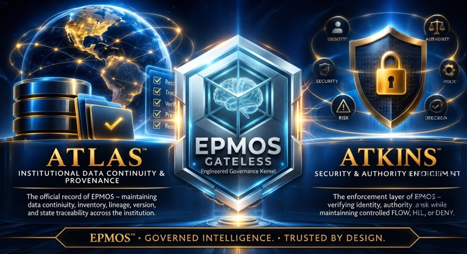

# EPMOS

## Enterprise Diagnostics & Runtime Repair

### Enterprise Autonomous Systems Repair & Diagnostics

Mission-critical failure analysis, anomaly isolation, and runtime remediation for self-hosted architectures, distributed micro data center nodes, and local-first AI pipelines. No cloud dependencies. No external lock-in.

[Submit Diagnostic Request](https://buy.stripe.com/fZu14o6BT7mp2wj0PqfEk0o) · [diagnostics.epmos.tech](https://diagnostics.epmos.tech)

### The Problem & The Standard

Modern autonomous runtimes and distributed nodes are unforgiving. When a harness fault, ledger corruption, or state-change violation brings down a local-first deployment, standard IT support and generic scripts fail because they lack architectural context.

You need deterministic isolation, governed-word verification, and proven remediation that preserves state without rolling back your entire environment.

### Core Service Offerings

#### 1. Anomaly Isolation & State Verification

**What it is:** Deep-dive forensic audit of server logs, Nginx access records, and container daemon registries (epmos-deployd). We isolate corrupted ledgers, trace unauthorized state changes, and verify SHA-256 integrity across your stack.

**Deliverable:** Complete isolation report and cryptographic verification pass.

#### 2. Autonomous Runtime Harness Repair

**What it is:** Direct intervention for stalled or oversized-body harness test runs, misconfigured companion labels, and broken Z-bend or routing logic within custom automation pipelines.

**Deliverable:** Restored execution, patch deployment, and resumed candidate code pipelines without data loss.

#### 3. Air-Gapped Environment Hardening

**What it is:** Security hardening and credential placement audits for local-first infrastructure, ensuring absolute isolation from external telemetry and vendor lock-in.

**Deliverable:** Hardened ingress rules, verified IMAP/SMTP bridge credentials, and locked-down reverse proxy configurations.

### Atlas & Atkins — Institutional Protection

#### Atlas — Institutional Data Continuity & Provenance

The official record of EPMOS — maintaining data continuity, inventory, lineage, version, and state traceability across the institution.

#### Atkins — Security & Authority Enforcement

The enforcement layer of EPMOS — verifying identity, authority and risk while maintaining controlled FLOW, HOLD, or DENY.

**Atlas and Atkins lanes: $10,000 each.**

### Pricing & Packaging

**The Diagnostic & Remediation Sprint — $2,500 flat per engagement**

Up to 72 hours of dedicated forensic isolation, harness repair, and runtime verification for a single local-first or distributed node environment. Includes complete SHA-256 integrity check and direct remediation deployment.

[Secure Your Diagnostic Slot](https://buy.stripe.com/fZu14o6BT7mp2wj0PqfEk0o)

### How It Works (The Protocol)

1. **Submit & Scope:** Provide your stack specifications (Python, FastAPI, Docker, Nginx) and describe the active failure vector.
2. **Isolate & Audit:** We run our proven adversarial testing gauntlet and cryptographic verification protocols against your logs and codebase.
3. **Remediate & Release:** The exact patch, harness fix, or state-recovery script is deployed directly to your environment. You are back online.
